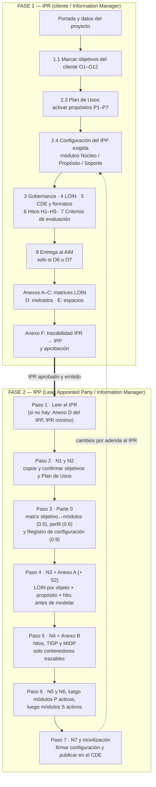
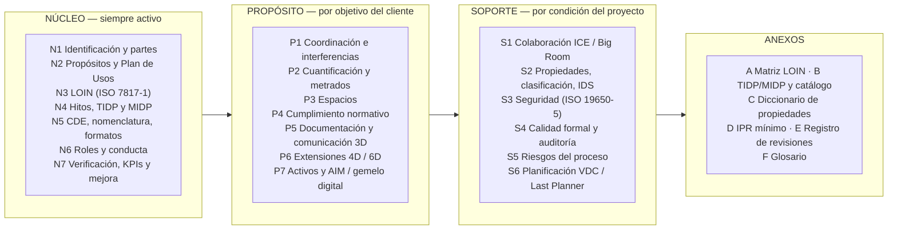
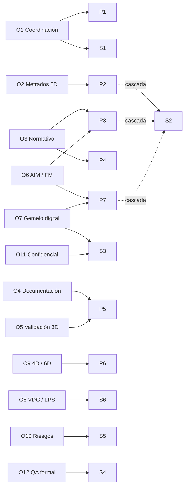

# Information Management — Plantillas modulares IPR e IPP

Plantillas para gestionar la información de proyectos de edificación privada bajo ISO 19650 y ISO 7817-1 (LOIN), con enfoque **Lean / VDC / IPD** y formatos **openBIM** (IFC, BCF, IDS, bSDD).

| Plantilla | Quién la redacta | Para qué sirve | Archivo |
|---|---|---|---|
| **IPR** — Information Product/Purpose Requirements (≡ **EIR**) | Appointing Party (cliente), con apoyo del Information Manager | Declara **qué** información necesita el cliente y **para qué** | [`plantillas/IPR_Modular_v2.0.docx`](plantillas/IPR_Modular_v2.0.docx) |
| **IPP** — Information Production Plan (≡ **BEP**) | Lead Appointed Party, con el Information Manager | Responde al IPR: **cómo, quién y cuándo** se produce esa información | [`plantillas/IPP_Modular_v2.0.docx`](plantillas/IPP_Modular_v2.0.docx) |

> **Estado normativo.** Los nombres IPR e IPP vienen del Draft International Standard de la revisión de ISO 19650 (consulta pública desde el 10 de marzo de 2026; publicación definitiva proyectada para 2027). **Esa revisión aún no es norma vigente.** Bajo el marco contractual aplicable hoy (ISO 19650-2:2018 y -3:2020) los mismos documentos se llaman **EIR** y **BEP**: su contenido y función son equivalentes y pueden presentarse como tales sin modificación. La especificación de niveles de información sigue ISO 7817-1:2024.

---

## 1. Principio de uso

**Un objetivo activa módulos; un módulo nunca se activa solo.**

Cada requisito de información se traza a una cadena única. Si un contenedor de información no llega hasta un objetivo del cliente, no se produce (principio *pull* de Lean Construction).


---

## 2. Flujo general: primero el IPR, luego el IPP

El IPR se llena **primero** y es la fuente de la que el IPP deriva su configuración. Los objetivos marcados en el IPR (sección 1.1) determinan qué módulos del IPP se activan.



### 2.1 Fase 1 — Cómo llenar el IPR

Orden recomendado. Las decisiones de los primeros pasos condicionan los siguientes.

| Paso | Sección del IPR | Qué se decide | Quién |
|---|---|---|---|
| 1 | Portada | Proyecto, tipo de activo, fase, disciplinas, Appointing Party, estado del documento | Information Manager |
| 2 | **1.1** Objetivos del cliente | **Marcar O1–O12.** Es el selector principal de todo el sistema | Cliente |
| 3 | **2.3** Plan de Usos | Activar propósitos P1–P7 con consumidor, decisión que habilitan e hitos. Un propósito sin consumidor no se activa | Cliente + IM |
| 4 | **2.4** Configuración del IPP exigida | Módulos mínimos que exige el cliente (Núcleo, Propósito, Soporte). Se deriva de 1.1 | IM |
| 5 | 3 · 4 · 5 | Gobernanza y escala de criticidad · marco LOIN (3 pilares, 5 aspectos) · CDE, formatos abiertos, nomenclatura | IM |
| 6 | 6 | Hitos H1–H5, TIDP/MIDP y test *pull* de existencia de contenedores | IM + cliente |
| 7 | 7 | Criterios con que se evaluará el IPP | Cliente |
| 8 | 8 | Requisitos de entrega al AIM. **Solo si O6 u O7** | Cliente |
| 9 | Anexos A, B, C | Matrices LOIN de Arquitectura, Estructuras y MEP por objeto × propósito × hito. «No aplicable» es respuesta válida | IM + disciplinas |
| 10 | Anexos D, E | Metrados (si P2) y espacios (si P3) | IM |
| 11 | Anexo F | Trazabilidad IPR → IPP y firma de aprobación | Cliente + IM |

### 2.2 Fase 2 — Cómo llenar el IPP

El IPP **no se completa de la página 1 a la última**. Se ensambla en siete pasos (Parte 0, sección 0.4); cada paso consume decisiones del anterior y así se evita el retrabajo.

| Paso | Módulos | Qué se hace | Salida |
|---|---|---|---|
| 1 | Anexo D | Leer el IPR. Si el cliente no emitió uno, redactar el IPR mínimo con él | IPR (o IPR mínimo) firmado |
| 2 | **N1, N2** | Identificar el proyecto y confirmar los **objetivos del cliente**; de ahí salen propósitos y condiciones | Objetivos y Plan de Usos |
| 3 | **Parte 0** | Aplicar la matriz objetivo → módulos (0.5) y el perfil de partida (0.6); firmar el Registro de configuración (0.9) | Registro de configuración |
| 4 | **N3, Anexo A**, S2 | Definir el LOIN por objeto × propósito × hito **antes de modelar** | Matriz LOIN aprobada |
| 5 | **N4, Anexo B** | Hitos, TIDP y MIDP, solo con contenedores trazables a un propósito activo | MIDP consolidado |
| 6 | N5, N6 → P activos → S activos | Primero CDE y roles; luego los módulos de propósito (orden P3 → P2 → P1 → P4 → P5 → P6 → P7); luego soporte (S1, S3, S6, S5, S4) | Módulos completos |
| 7 | **N7**, N5-8 | Cerrar KPIs con lo que realmente quedó activo, movilizar al equipo y **publicar** el IPP en el CDE | IPP en estado *Published* |

**Por qué ese orden:** P3 (espacios) va primero porque P2, P4 y P7 lo consumen; P1 necesita la georreferenciación de N5; P7 depende de P3 y S2; S4 (auditoría) va último porque audita contra lo definido en N3 y S2.

---

## 3. Estructura del IPP: tres capas de módulos



---

## 4. Qué módulos activar según el objetivo

Los módulos **N1–N7 se activan siempre.** Esta matriz (IPP, sección 0.5) indica qué módulos adicionales activa cada objetivo marcado en el IPR 1.1.

**●** activar (necesario para cumplir el objetivo) · **○** recomendado (activar salvo razón documentada)

| ID | Objetivo del cliente | Propósito | Soporte |
|---|---|---|---|
| **O1** | Coordinación multidisciplinar y constructibilidad | **P1** | **S1** · ○ S2, S4, S5 |
| **O2** | Certeza de costo: metrados desde el modelo (5D) | **P2** · ○ P3 | **S2** · ○ S4 |
| **O3** | Cumplimiento normativo y licenciamiento | **P3, P4** · ○ P5 | **S2** |
| **O4** | Documentación de construcción desde el modelo | **P5** | ○ S4 |
| **O5** | Validación del diseño con cliente y usuarios | **P5** | ○ S1 |
| **O6** | Continuidad hacia la operación (AIM / FM) | **P3, P7** | **S2** · ○ S3, S4 |
| **O7** | Gemelo digital | **P3, P7** | **S2, S3** |
| **O8** | Control de producción de diseño (VDC / Last Planner) | — | **S1, S6** · ○ S5 |
| **O9** | Secuenciación 4D o análisis energético 6D (por adenda) | **P6** · ○ P3 | ○ S2 |
| **O10** | Gestión de riesgos del proceso (proyecto complejo) | — | **S5** · ○ S4, S6 |
| **O11** | Información sensible o confidencial | — | **S3** |
| **O12** | Auditoría o QA formal exigido por contrato | — | **S4** · ○ S2 |

**Dependencias en cascada:** si se activa P2, P3 o P7, **S2 pasa a obligatorio** aunque no figure en la fila del objetivo. Otras dependencias: P1 requiere N3 y N5 (georreferencia); P4 requiere P3 y S2; P6 requiere P3 (6D); S6 requiere N4 y S1; S4 requiere N7 y S2.



### Perfiles de configuración (punto de partida, IPP 0.6)

| Perfil | Cuándo usarlo | Módulos además del núcleo |
|---|---|---|
| **A — Esencial** | 1–2 disciplinas, un solo propósito | Un módulo P (+ S2 si es P2, P3 o P7) |
| **B — Coordinado** | Diseño multidisciplinar (ARQ + EST + MEP) con coordinación y presupuesto de control | P1, P2, S1, S2 |
| **C — Integrado Lean / IPD** | Proyecto complejo, producción de diseño planificada y medida | B + S4, S5, S6 (+ P5) |
| **D — Ciclo de vida (AIM)** | El cliente operará el activo y exige datos para FM o gemelo digital | C + P3, P7, S3 (+ P4) |

Se parte del perfil más cercano y se ajusta con la matriz anterior. Los perfiles no son obligatorios.

---

## 5. Hitos de entrega (comunes a IPR e IPP)

| Hito | Descripción | Estado CDE al cierre |
|---|---|---|
| **H1** Cabida | Estudio de factibilidad volumétrica | Shared |
| **H2** Anteproyecto | Anteproyecto arquitectónico y de ingenierías | Shared |
| **H3** Proyecto para revisión | Revisión del cliente y entidades | Shared → Published |
| **H4** Proyecto detallado / obra | Expediente técnico para construcción | Published |
| **H5** As-built *(opcional)* | Modelo verificado y datos de activos | Published |

Los hitos se definen **una sola vez** (IPR 6.1 / IPP N4-1); los demás módulos los citan y no redefinen fechas.

---

## 6. Principios que rigen ambos documentos

- **LOIN, no LOD.** Cada objeto se especifica con tres pilares (geométrico, alfanumérico, documentación) y, dentro del geométrico, cinco aspectos independientes: detalle, dimensionalidad, ubicación, apariencia y comportamiento paramétrico (ISO 7817-1:2024). Se pregunta siempre: ¿por qué (propósito)?, ¿cuándo (hito)?, ¿quién (actor)?, ¿qué (objeto)?
- **«No aplicable» es una respuesta válida** y es la herramienta principal contra la sobreentrega de información.
- **Fuente única de cada dato.** Cada dato vive en un solo lugar (IPP 0.8) y los demás módulos lo citan por código, sin copiarlo.
- **Test *pull* de existencia.** Un contenedor entra al MIDP solo si responde a: ¿a qué propósito sirve?, ¿quién lo consume?, ¿qué decisión habilita y cuándo?, ¿qué LOIN lo define?, ¿quién lo produce y en qué hito?
- **Reporte temprano sin estigma.** Una sola escala de criticidad (GRAVE / MEDIA / LEVE) con plazos de respuesta definidos.
- **Mejora continua.** Cada sesión ICE revisa también el proceso; las lecciones aprendidas se registran de forma estructurada y alimentan el estándar.
- **openBIM primero.** IFC 4.x para intercambio, BCF para incidencias, IDS para validación automatizada, bSDD para clasificación.

---

## 7. Cómo extender la plantilla

Para añadir un propósito nuevo (adquisiciones, fabricación digital, sostenibilidad), siga IPP 0.10:

1. Registrar el objetivo del cliente (N2-1) y el propósito (N2-2), con consumidor y decisión que habilita.
2. Crear el módulo con la ficha estándar.
3. Añadir al Anexo A las filas LOIN del nuevo propósito.
4. Añadir al Anexo B los contenedores trazables y actualizar el MIDP.
5. Actualizar las matrices 0.3, 0.5, 0.7 y 0.8 y el registro de configuración.
6. Si el IPR cambia, tramitar primero la **adenda al IPR**.

---

## Estructura del repositorio

```
Information_Management/
├── README.md
├── LICENSE
└── plantillas/
    ├── IPR_Modular_v2.0.docx   # Fase 1: requisitos del cliente
    └── IPP_Modular_v2.0.docx   # Fase 2: plan de producción (respuesta al IPR)
```

Versión de las plantillas: **2.0 — Octubre 2026 (borrador para revisión)**. Licencia: ver [`LICENSE`](LICENSE).
